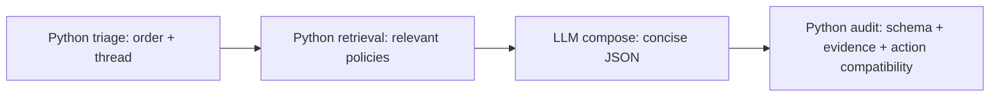
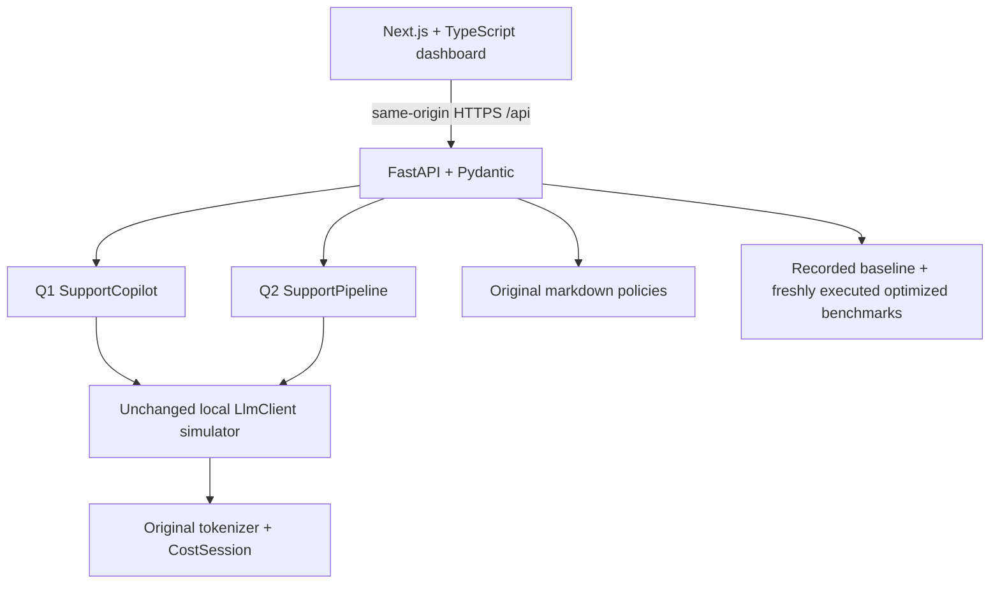
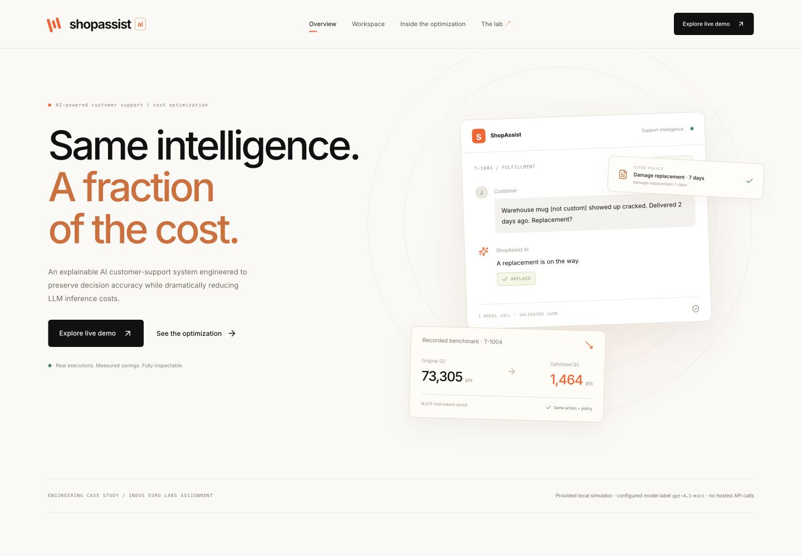
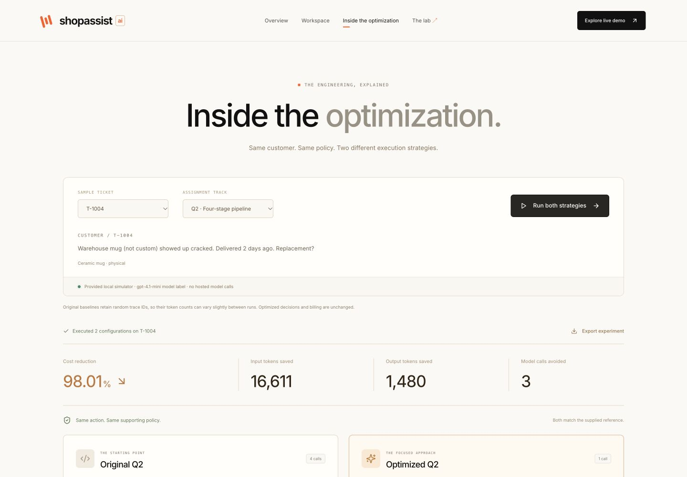
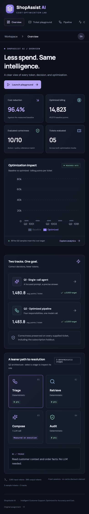

# ShopAssist AI — LLM Cost Optimization Lab

Intelligent Customer Support. Optimized for Accuracy and Cost.

A working Python optimization solution for both IndusEuro Labs assignment tracks, with a Next.js engineering dashboard, FastAPI execution API, real token accounting, and reproducible benchmarks.

**Engine transparency:** this uses the assignment's provided **local LLM simulator**. Its configured model string is `gpt-4.1-mini`; it does not call the hosted model. Billing points are assignment units, not dollars. The simulator internally uses the supplied reference policy function, unchanged. Neither optimized agent imports evaluation code or maps ticket IDs to answers.

**Live dashboard:** https://shopassist-cost-lab.vercel.app  
**API health:** https://shopassist-cost-lab.vercel.app/api/health  
**API docs:** https://shopassist-cost-lab.vercel.app/api/docs

## Product experience

The product now includes a warm editorial landing page, an engineering workspace, real live before/after execution, Prompt X-Ray and an executable optimization lab.

- [Live product](https://shopassist-cost-lab.vercel.app/)
- [Engineering workspace](https://shopassist-cost-lab.vercel.app/workspace)
- [Inside the optimization](https://shopassist-cost-lab.vercel.app/compare)
- [Optimization lab](https://shopassist-cost-lab.vercel.app/lab)

The redesigned interface preserves the existing agents and billing exactly. Read the [redesign implementation and verification notes](docs/REDESIGN.md). The new read-only API endpoints are `POST /api/explain/experiments` and `GET /api/explain/transparency`.

## Attribution

Based on [IndusEuro Labs’ original assignment](https://github.com/Induseuro-labs/intern-assignment-llm-cost-optimization). The original repository is a read-only source. This is an independent submission repository owned by `neha1422`. The source README is preserved in [docs/ORIGINAL_ASSIGNMENT.md](docs/ORIGINAL_ASSIGNMENT.md). Upstream has no license file; this project does not assert a new license over their material.

## Measured results

Fresh billing session per ticket; zero cached-input tokens. All five supplied tickets are evaluated in both tracks, including T-1091. These are executed simulator results.

| Ticket | Q1 baseline | Q1 optimized | Savings | Q2 baseline | Q2 optimized | Savings |
|---|---:|---:|---:|---:|---:|---:|
| T-1001 | 8,895 | 1,662 | 81.32% | 73,350 | 1,665 | 97.73% |
| T-1002 | 8,985 | 1,452 | 83.84% | 73,332 | 1,455 | 98.02% |
| T-1003 | 8,724 | 1,500 | 82.81% | 73,503 | 1,503 | 97.96% |
| T-1004 | 8,880 | 1,461 | 83.55% | 73,305 | 1,464 | 98.00% |
| T-1091 | 8,913 | 1,329 | 85.09% | 73,686 | 1,332 | 98.19% |
| **Total** | **44,397** | **7,404** | **83.32%** | **367,176** | **7,419** | **97.98%** |

- **Correctness:** 5/5 per track for both graded fields, `action` and `kb_article`.
- **Q1 target:** every ticket below 3,000 points.
- **Q2 target:** every ticket below 2,500 points.
- Original billing formula remains `uncached input × 3 + cached input × 0.3 + output × 15`.
- Exact call/stage breakdowns: [benchmarks/results.json](benchmarks/results.json). Baseline random trace IDs can cause small tokenizer variations on reruns.

## Q1 solution

`SupportCopilot.handle_ticket(ticket_id)` retains one model call and its original resolution fields. It sends compact order JSON, a concise policy instruction, the customer thread, and relevant original policies. It removes UUID prefixes, few-shot examples and verbose reasoning requests. Parsing accepts plain, fenced and prose-prefixed JSON, validates field types and rejects unsupported actions or policy IDs.

Fact-aware lexical retrieval keeps matching policy exceptions plus the general returns fallback. It chooses candidate evidence, never the final answer. Prompts remain below the 1,024-token caching threshold; padding them just to claim caching would increase cold cost. No cache discount is claimed.

### Required one-ticket breakdown

T-1001: **324 input**, **0 cached**, **46 output** → `324×3 + 46×15 = 1,662` points.

## Q2 solution

`SupportPipeline.handle_ticket(ticket_id)` preserves four understandable responsibilities, with only composition billed to the LLM:



The original uses four model calls and repeatedly sends huge expanded help-center sections. The optimized version loads original source policies directly, removes duplicated triage and order blocks, and records a trace for every logical stage. Deterministic stage token counts describe text processed; they are **not** billed model tokens.

The audit validates structure, allowed actions, retrieved citations, and action/article compatibility. It does not independently prove semantic business correctness; the simulator evaluation checks the final decision separately.

### Required two-ticket breakdown

| Stage | T-1004 physical replacement | T-1002 digital denial |
|---|---:|---:|
| Triage | 0 points, Python | 0 points, Python |
| Retrieve | 0 points, Python | 0 points, Python |
| Compose | 1,464 points | 1,455 points |
| Audit | 0 points, Python | 0 points, Python |

T-1004: 308 input + 36 output tokens → 1,464 points. T-1002: 290 input + 39 output tokens → 1,455 points. Both have zero cached tokens. Exact stage results are in the benchmark JSON.

## Application architecture



Seven views: overview, ticket playground, pipeline explorer, cost analytics, searchable knowledge base, benchmark dashboard and architecture. Charts use measured data. Ticket execution calls Python. The benchmark button reruns optimized agents; it explicitly labels the baseline as recorded. Full baseline reruns remain available through the CLI.

## Run locally

Python 3.9+ and Node 20.9+ (Node 22 recommended).

```bash
python3 -m venv .venv
source .venv/bin/activate
pip install -r requirements.txt
npm --prefix web ci
npm --prefix web run build
uvicorn preview:app --host 127.0.0.1 --port 3000
```

Open http://127.0.0.1:3000. The browser and API are served together. No model keys are needed. The tokenizer downloads its public encoding on first use if it is not already cached.

For separate development servers and production hosting, see [docs/DEPLOYMENT.md](docs/DEPLOYMENT.md). Configuration is documented in `.env.example`.

## Test and reproduce

```bash
# Acceptance, unseen boundaries, parser validation and API integration
pytest tests/test_optimization.py tests/test_api.py tests/test_explain.py -q
# Regenerate original + optimized measurements (slow unchanged baseline KB builder)
python -m benchmarks.run
# Original assignment launchers
python question1/run.py
python question2/run.py
# Complete original + additional suite
pytest -q
# Frontend validation
npm --prefix web run build
npm --prefix web run typecheck
```

Executed verification: **61 acceptance/API/instrumentation tests passed**, production build and TypeScript checks passed. The full suite after optimization reports **65 passed, 2 failed** (only the obsolete high-cost assertions below). The original six tests passed before optimization. After optimization, the two original tests named `test_baseline_cost_is_high` intentionally fail because those tests assert that the old wasteful cost remains high. They are preserved unchanged. Run the acceptance suite for actual correctness and cost ceilings; do not inflate costs to satisfy baseline assertions.

The additional tests cover all supplied tickets, unseen physical/digital/custom/subscription order combinations, 7/8-day damage and 30/31-day refund boundaries, malformed completions, citation/schema validation, API error handling and live benchmark reruns. These establish simulator behavior, not general hosted-model accuracy.

## API

| Method | Path | Purpose |
|---|---|---|
| GET | `/api/health` | Engine status |
| GET | `/api/tickets` | Sample catalog |
| GET | `/api/tickets/{ticket_id}` | Customer thread and order |
| POST | `/api/agent/q1/run` | Execute single-call agent |
| POST | `/api/agent/q2/run` | Execute optimized pipeline |
| GET | `/api/benchmarks/results` | Recorded reproducible measurements |
| POST | `/api/benchmarks/run` | Rerun optimized suite |
| GET | `/api/kb/articles?q=...` | Search source policies |
| GET | `/api/kb/articles/{id}` | Read a policy |
| GET | `/api/docs` | Interactive OpenAPI documentation |

POST execution body: `{"ticket_id":"T-1001"}`. Direct `backend.app:app` routes omit `/api`. The API uses sample allowlists, Pydantic validation, explicit CORS, a body cap, per-process concurrency limits, request IDs, structured request logs, response timeouts and sanitized internal errors.

Executed browser/API checks and test details: [docs/VERIFICATION.md](docs/VERIFICATION.md).

## Trade-offs

- Lexical search is transparent and adequate for this small real KB; a large multilingual production corpus needs retrieval evaluation and stronger indexing.
- Concise prompts reduce billed cost here. Real models require provider usage measurement, separate correctness evaluation and retry budgets.
- Customer replies come from the simulator; this demo does not execute real refunds or shipments.
- The public demo records no durable user history. Metric cards summarize the measured suite, not lifetime traffic.
- Stage timings are wall-clock observations, not guaranteed production latency. Baseline KB creation is slow and intentionally unchanged.

## Screenshots





[Mobile screenshot](docs/screenshots/redesign-home-mobile.jpg) · [Implementation and verification notes](docs/REDESIGN.md)

### Original dashboard (before redesign)


