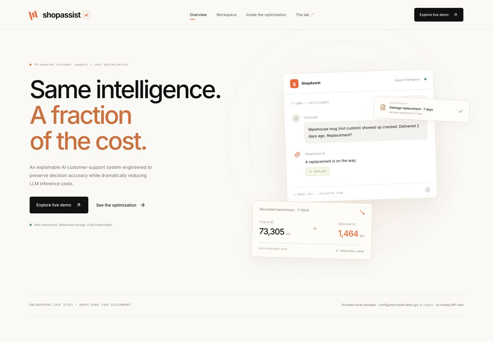
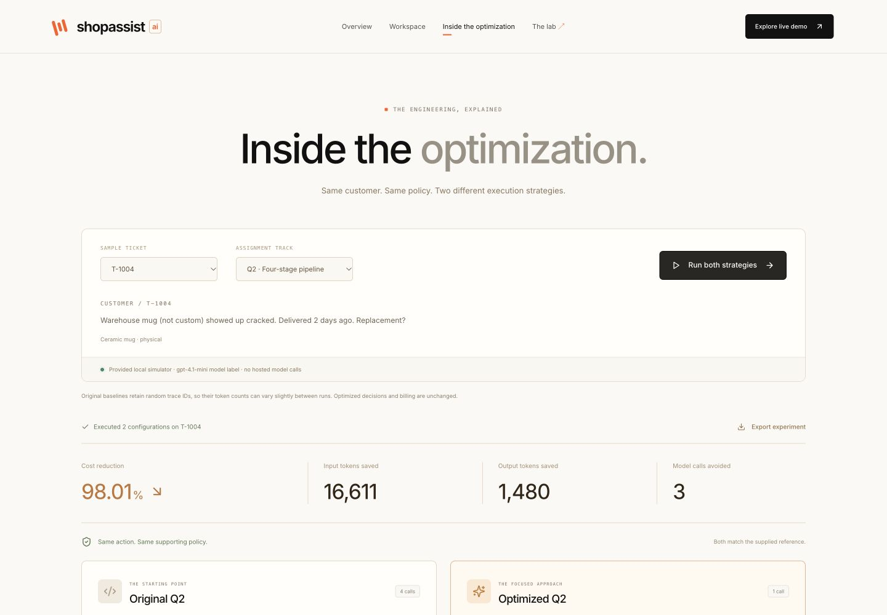

# Premium UI redesign and execution transparency

This update extends the existing application. It preserves Q1, Q2, every shared module, evaluator, original assignment test, existing benchmark logic, stored measurements, and all pre-existing API endpoints.

## Experiences

- `/`: original ShopAssist product identity, warm editorial layout, a real T-1004 support conversation, recorded cost comparison, scroll-driven engineering story, model transparency, accessible FAQs.
- `/workspace`: all seven existing engineering views, restyled. The playground presents customer context, live conversation, and decision intelligence. The pipeline exposes actual stage input/output data. Analytics offer an explicit log axis and a separate zero-based optimized detail view. Benchmarks distinguish four public samples from the subscription holdout, with an additional recorded automated-test matrix.
- `/compare`: original vs optimized Q1 or Q2, executed live on the same selected ticket. Actual action, citation, prompt, completion, model calls, token counts, points and timings. Prompt X-Ray highlights actual changed lines; long previews are bounded and the complete traces can be downloaded.
- `/lab`: run selected complete executable configurations: original Q1, original Q2, optimized Q1 and optimized Q2. No fictional compression/retrieval/cache switches or additive attribution assumptions.

The supplied screenshots and Fin site informed the broad warm-white, orange, editorial direction. The logo, layouts, code-native diagrams, conversation panels and visual identity are original to ShopAssist.

## Read-only instrumentation

The sole addition to `backend/app.py` is registration of `backend.explain.router`. Existing endpoint implementations remain unchanged. `/explain/experiments` accepts only supplied sample tickets and four supported configuration identifiers. Each run creates a fresh CostSession and wraps the instance's original LlmClient.chat with a passive observer. The observer calls the original method with unchanged arguments and returns its original completion, recording the actual prompt and billing result.

Q1/Q2 source files and `shared/` are untouched. No source prompt, decision policy, retrieval rule, tokenizer or billing value is altered. The reference answers are used only by this evaluation/instrumentation layer to display correctness; the agents remain independent of them.

### Q2 baseline initialization

The original expanded-help-center generator takes minutes because it repeatedly tokenizes its growing synthetic text. Its exact output was generated locally using the original function and stored as a compressed read-only resource. The baseline instance is hydrated with the constructor-equivalent CostSession, LlmClient and this exact text, then executes its original `handle_ticket` and four original node methods.

`backend/resources/baseline-manifest.json` records the decompressed SHA-256. The resource is verified before use. This changes cold setup time only; prompts, context, model calls, completions and billing calculations still come from the preserved baseline methods. The UI reports initialization/hydration separately and explicitly excludes original text-generation time from the execution-duration comparison. Original random trace IDs remain random, so baseline token counts can vary slightly across reruns, as before.

## Regression evidence

- Before update: full suite 41 passed, 2 failed.
- After update: full suite 65 passed, 2 failed.
- Both unchanged failures assert deliberately high baseline costs against optimized agents.
- Acceptance/API/instrumentation subset: 61 passed, including all 20 configuration/ticket combinations.
- Exact snapshots: all ten optimized action/article/cost/call breakdowns match the pre-redesign snapshot.
- Eighteen protected source, test and benchmark files are byte-identical.
- Build and TypeScript checks pass.

See `benchmarks/redesign-regression.json`, `benchmarks/redesign-tests.json` and the captured test logs in `docs/redesign/` for executed evidence. The displayed local pytest record is separate from the benchmark button, which continues to rerun optimized sample agents.

## Routing and deployment

The same Vercel project, domain, API mount and Python runtime are retained. An explicit static route maps `/workspace`, `/compare` and `/lab` to their Next.js exports. No production environment variables or unrelated project settings are modified.

## Interpretation limits

The configured model string is `gpt-4.1-mini`, but actual execution is the provided local Python simulator. Metrics are assignment billing points, not provider dollars. This update does not create a hosted model integration or prove real-world model accuracy. Full prompts contain only public sample data, without credentials.

## Final public verification

The final deployment is `dpl_7AWdpt9Xhm5Q2uPgwSC4H6UiU6yJ`, serving the existing https://shopassist-cost-lab.vercel.app domain. Public API checks verified all ten optimized ticket results and all twenty configuration/ticket combinations. Public browser checks verified the hero, comparison, Prompt X-Ray, Q1/Q2 playground, pipeline audit, log-scale analytics, policy search, benchmark execution, recorded test evidence and direct policy navigation. Final mobile document width is 390px at a 390px viewport. No console warnings/errors were captured.

Counters animate only toward real measured values, with reduced-motion support. Run controls are gated on sample readiness. The frontend build copies the executed pytest JSON report into the Next.js bundle with `web/scripts/sync-verification.mjs`; the generated copy is ignored by Git.

